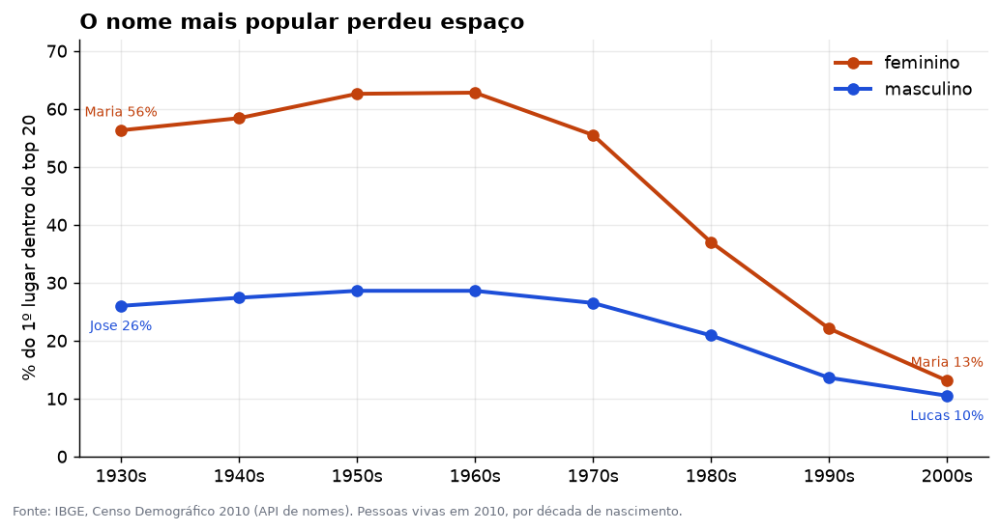
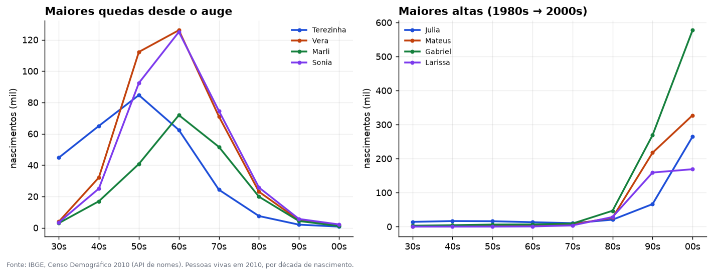
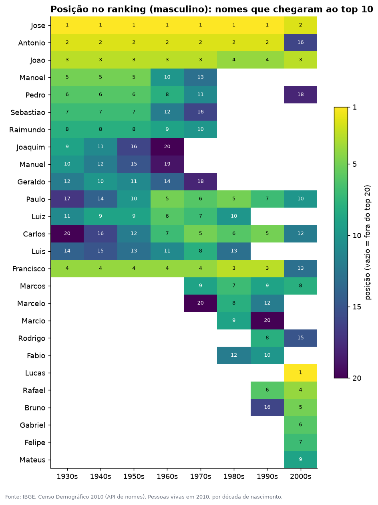

# 📊 Nomes do Brasil

[](https://github.com/Borniotti/nomes-do-brasil/actions/workflows/testes.yml)

[English below](#english)

**Como os nomes mais comuns do Brasil mudaram entre os anos 1930 e 2000?** Uma análise de dados com **Python e pandas** sobre o Censo 2010 do IBGE: coleta pela API pública, tratamento, métricas, gráficos e testes.

## Principais descobertas

### 1. Os brasileiros passaram a variar muito mais os nomes



Nos anos 1950 e 1960, **Maria** sozinha somava **63%** de todas as meninas com os 20 nomes femininos mais comuns. Nos anos 2000 essa fatia caiu para **13%**. Com **José** aconteceu o mesmo: de 29% para 14% nos anos 1990, até perder o primeiro lugar para **Lucas** nos anos 2000. A queda começa nos anos 1970 e acelera depois de 1980.

### 2. Nomes que foram febre e quase sumiram



**Terezinha**, **Vera**, **Marli** e **Sônia** tiveram o auge nos anos 1950 e 1960 e caíram **mais de 98%** desde então. No sentido oposto, **Júlia**, **Mateus** e **Gabriel** cresceram **mais de 1.100%** entre os anos 1980 e 2000.

### 3. A renovação é mais forte entre os meninos



O mapa mostra a posição de cada nome em cada década. Entre os homens, o top 3 (José, Antônio, João) ficou praticamente igual por 70 anos, até que nos anos 2000 **Lucas** assumiu o primeiro lugar, e **Antônio** caiu do 2º para o 16º. Entre as mulheres, Maria e Ana mantêm o 1º e o 2º lugar em todas as décadas, mas o resto do ranking se renova a cada geração ([veja o mapa feminino](graficos/posicoes-feminino.png)).

Todas as tabelas com os números estão em [RESULTADOS.md](RESULTADOS.md).

## Cuidados com os dados

- O Censo conta **quem estava vivo em 2010**. Por isso há menos registros das décadas antigas, e a análise compara **proporções dentro de cada década**, não totais entre décadas.
- Quem nasceu antes de 1930 vem agrupado num período só, então foi deixado de fora.
- A API devolve os nomes sem acento ("JOSE", "SONIA"). No texto acima os acentos foram recolocados; nos gráficos e tabelas eles aparecem como vêm do IBGE.
- O ranking da API traz os 20 primeiros de cada década e sexo; a "participação do 1º lugar" é calculada dentro desse grupo.

## Como foi feito

| Etapa | Arquivo | O que faz |
|---|---|---|
| Coleta | [`nomes/coleta.py`](nomes/coleta.py) | Baixa da API do IBGE com novas tentativas em caso de erro e guarda as respostas para não repetir pedidos. Salva em [`dados/`](dados). |
| Transformação | [`nomes/transformar.py`](nomes/transformar.py) | Funções pandas puras: top N por década, concentração, picos, crescimento, estreantes e matriz de posições. |
| Gráficos | [`nomes/graficos.py`](nomes/graficos.py) | matplotlib com um estilo único e fonte citada em todos os gráficos. |
| Relatório | [`analisar.py`](analisar.py) | Roda tudo e gera os gráficos e o `RESULTADOS.md`. |
| Testes | [`tests/`](tests) | 13 testes com dados pequenos feitos à mão (resultado conhecido) e conferência do formato dos CSVs reais. |

O GitHub Actions roda os testes, confere o estilo com Ruff e executa a análise inteira a cada mudança.

## Rodar no seu computador

Com Python 3.11 ou mais novo:

```bash
git clone https://github.com/Borniotti/nomes-do-brasil.git
cd nomes-do-brasil
pip install -r requirements-dev.txt
python analisar.py          # gera gráficos e RESULTADOS.md a partir de dados/
python -m nomes.coleta      # (opcional) baixa os dados de novo do IBGE
pytest                      # roda os testes
```

Fonte dos dados: [IBGE, API de Nomes do Censo 2010](https://servicodados.ibge.gov.br/api/docs/nomes?versao=2).

> Projeto feito com a ajuda de IA (Claude), com revisão e decisões minhas.

---

## English

**How did Brazil's most common first names change from the 1930s to the 2000s?** A data analysis in **Python and pandas** on IBGE's 2010 Census name data: API collection, cleaning, metrics, charts and tests. (Charts and code are in Portuguese.)

**Key findings**

1. **Names became far more diverse.** In the 1950s–60s, *Maria* alone accounted for 63% of girls among the top 20 female names; by the 2000s that share was 13%. *José* fell from 29% to 14% by the 1990s and lost first place to *Lucas* in the 2000s.
2. **Boom-and-bust names.** *Terezinha*, *Vera*, *Marli* and *Sônia* peaked in the 1950s–60s and dropped more than 98% since. *Júlia*, *Mateus* and *Gabriel* grew more than 1,100% between the 1980s and 2000s.
3. **Male names were stable for 70 years, then turned over.** The top 3 (José, Antônio, João) barely moved until the 2000s, when Lucas took the lead and Antônio fell from 2nd to 16th.

**Caveats:** the census counts people alive in 2010, so older decades are under-represented; the analysis compares shares within each decade. Pre-1930 births are a single bucket and are excluded.

**Stack:** `urllib` with retries and response caching for collection, pure pandas transforms, matplotlib charts, 13 pytest tests, Ruff, and GitHub Actions running tests plus the full analysis on every push.

```bash
pip install -r requirements-dev.txt
python analisar.py       # regenerate charts and RESULTADOS.md
pytest
```

> Built with AI assistance (Claude), reviewed and directed by me.

License: [MIT](LICENSE). Data: IBGE (public).
